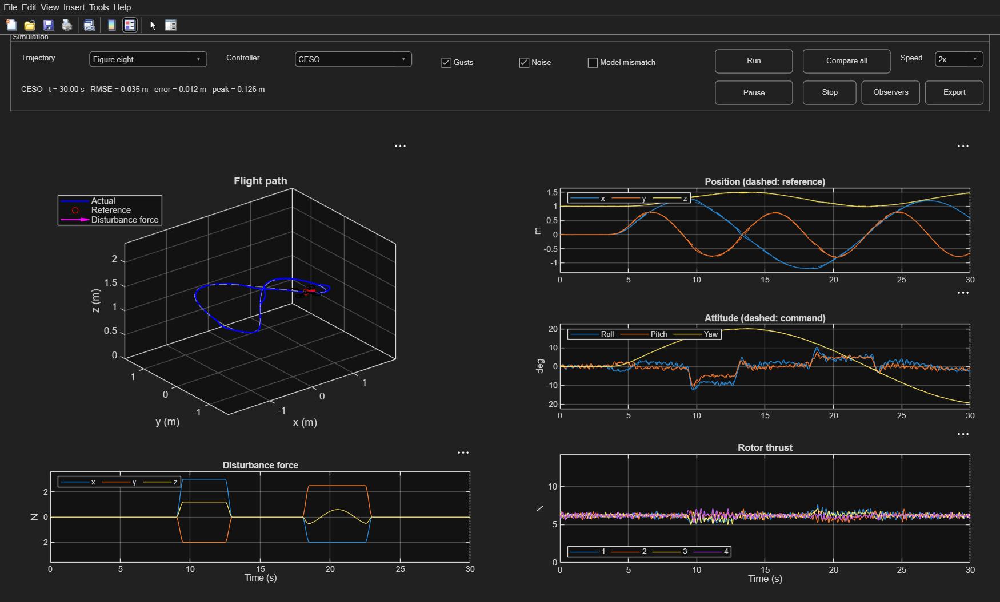
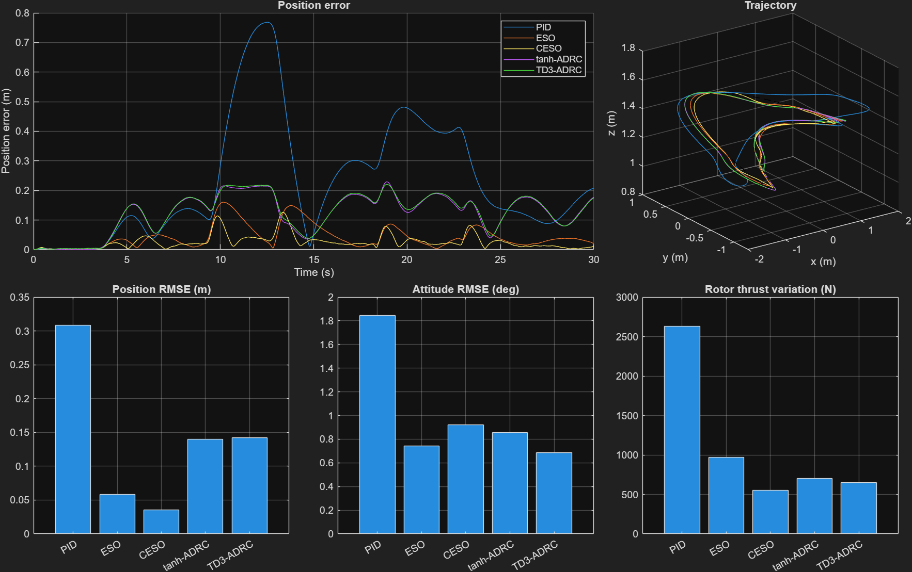
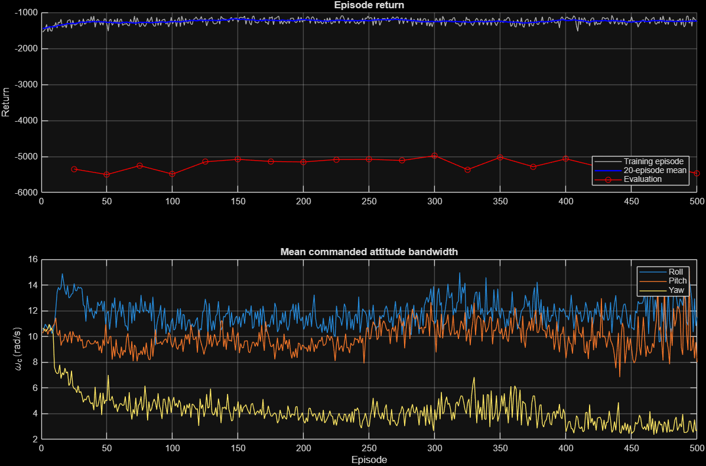
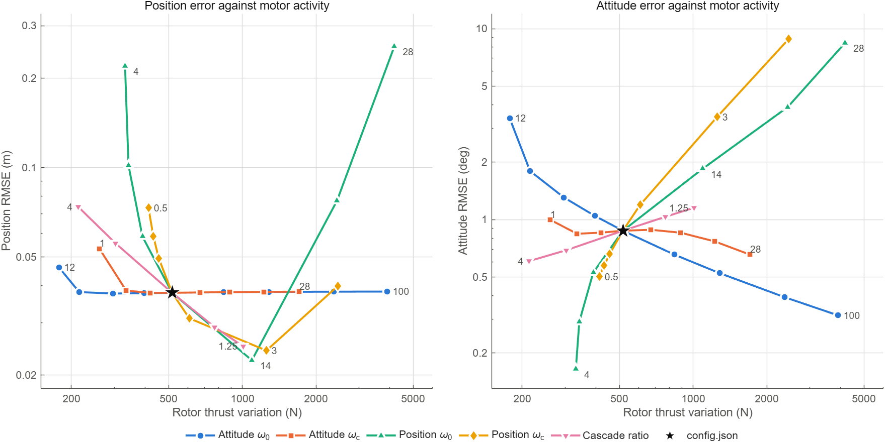

# ADRC quadrotor control: cascade ESO and TD3-tuned tanh-ADRC

A quadrotor simulation that compares five flight controllers built around
**active disturbance rejection control (ADRC)**. It implements two recent papers:

- **Cascade ESO (CESO)**, Benyahia et al., 2025: two extended state observers in
  series, where the second one estimates what the first one missed.
- **TD3-ADRC**, Cai et al., 2026: a nonlinear tanh-based ADRC whose attitude
  gains are retuned online by a TD3 reinforcement-learning agent.

Everything is implemented twice, in **MATLAB** and in **Python/NumPy**, from one
shared `config.json`. The two versions agree to about 1e-11, so each one checks
the other.



## Contents

- [What it does](#what-it-does)
- [Results](#results)
- [How it works](#how-it-works)
- [Getting started](#getting-started)
- [Configuration](#configuration)
- [Validation](#validation)
- [Project structure](#project-structure)
- [Limitations](#limitations)
- [References](#references)

## What it does

- Flies a 17-state quadrotor along four paths: **hover**, **circle**,
  **figure-eight** and **waypoints**, each for 30 s.
- Hits it with two **wind gusts** (9–13 s and 18–23 s), **sensor noise**, and
  optionally a **model mismatch** (real mass +15 %, different inertia) that the
  controller does not know about.
- Compares five controllers in the same control structure:

| Controller | Type | Idea |
|---|---|---|
| PID | Baseline | Filtered derivative, integral with anti-windup |
| ESO | Linear ADRC | One third-order observer per axis estimates and cancels the total disturbance |
| CESO | Cascade ADRC | Two observer stages (ω₀/2 and ω₀); the disturbance estimates add up |
| tanh-ADRC | Nonlinear ADRC | Tracking differentiator, tanh-ESO and tanh feedback law |
| TD3-ADRC | Learned gains | tanh-ADRC whose attitude bandwidth ωc is chosen by a TD3 agent every 50 ms |

- Trains the TD3 agent from scratch in NumPy (hand-written back-propagation and
  Adam, no deep-learning framework).
- Includes an interactive MATLAB dashboard, comparison plots and a validation suite.

## Results

### Figure-eight, 30 s, with gusts and noise

| Metric | PID | ESO | CESO | tanh-ADRC | TD3-ADRC |
|---|---:|---:|---:|---:|---:|
| Position RMSE (m) | 0.309 | 0.058 | **0.035** | 0.140 | 0.142 |
| Peak position error (m) | 0.768 | 0.160 | **0.126** | 0.229 | 0.221 |
| Attitude RMSE (deg) | 1.845 | 0.742 | 0.920 | 0.858 | **0.686** |
| Rotor thrust variation (N) | 2634 | 970 | **554** | 702 | 648 |



- **CESO** tracks position best and works the motors the least.
- **tanh-ADRC and TD3-ADRC** lag on curved paths, because the paper's control
  law has no reference-acceleration term. ESO and CESO work on the tracking error,
  so the reference acceleration is folded into their disturbance estimate.
- **Rotor thrust variation** is the sum of all sample-to-sample motor thrust
  changes: lower means smoother motors.

### TD3 against the same controller with fixed gains

| Path | Attitude RMSE, fixed (deg) | Attitude RMSE, TD3 (deg) | Rotor variation, fixed (N) | Rotor variation, TD3 (N) |
|---|---:|---:|---:|---:|
| Hover | 0.836 | **0.709** | 691 | **612** |
| Circle | 0.862 | **0.697** | 695 | **621** |
| Figure-eight | 0.858 | **0.686** | 702 | **648** |
| Waypoints | 0.862 | **0.655** | **697** | 709 |

The learned gain schedule cuts attitude error by 15–24 % on every path and motor
activity by 7–12 % on three of four, with position error unchanged (within
1.5 %).

It still scores slightly lower on the training reward (−4977 against −4185 for
fixed gains over four evaluation flights). The whole gap is the gain-change
penalty, which a fixed gain never pays.



### Paper settings against the improved settings

Training with the paper's own settings produced a bang-bang policy: each gain
jumped across its full 1–20 rad/s range about every 10 ms, the motors chattered,
and the drone crashed on hover and circle in 30 s flights. Three causes were
identified and fixed in the `improved` variant (the default):

| Setting | `paper` | `improved` |
|---|---|---|
| Agent decision period | 10 ms | 50 ms, with a 20 rad/s² rate limit |
| Reward | Eq. 35 only | Eq. 35 plus gain-change and rotor-activity penalties |
| Episode length | 15 s (misses the second gust) | 30 s |
| Replay buffer | 10 000 | 200 000 |
| Agent sees its own gains | no | yes |
| Outcome | crashes on hover and circle | no crashes in training or validation |

A smaller gain-change penalty (0.002 instead of 0.01) was also tried. It tied
fixed gains on reward but flew worse, so it was not kept.

### What each CESO setting actually does

`python/sensitivity.py` changes one CESO setting at a time and flies each value
80 times: four paths, mismatch on and off, ten noise seeds. All 4080 flights
finished without a crash. These figures average over paths and mismatch, so the
baseline differs slightly from the figure-eight table above.



| Change from `config.json` | Position RMSE (m) | Peak position error (m) | Attitude RMSE (deg) | Rotor thrust variation (N) |
|---|---:|---:|---:|---:|
| None | 0.038 | 0.119 | 0.874 | 516 |
| Attitude ωc 7 → 3 | 0.039 | 0.126 | 0.843 | 335 |
| Attitude ωc 7 → 28 | 0.038 | 0.119 | 0.655 | 1708 |
| Attitude ω₀ 36 → 24 | 0.038 | 0.122 | 1.306 | 296 |
| Attitude ω₀ 36 → 48 | 0.038 | 0.119 | 0.656 | 837 |
| Position ω₀ 10 → 14 | 0.022 | 0.078 | 1.846 | 1094 |
| Position ω₀ 10 → 20 | 0.077 | 0.198 | 3.887 | 2437 |
| Position ωc 1.5 → 3 | 0.024 | 0.079 | 3.453 | 1254 |
| Cascade ratio 2 → 1.25 | 0.025 | 0.081 | 1.153 | 1007 |
| Cascade ratio 2 → 3 | 0.056 | 0.170 | 0.692 | 304 |

- **Attitude ωc is the weakest setting.** From 3 to 28 rad/s, position RMSE stays
  within 0.0379–0.0385 m. Lowering it from 7 to 3 cuts rotor variation by 35 % for
  6 % more peak error. To reach 0.66° of attitude error, ωc = 28 needs twice the
  rotor variation of ω₀ = 48.
- **Position ω₀ has a limit.** Raising it to 14 cuts position RMSE by 41 %, but at
  20 position RMSE is already twice the baseline.
- **Position ω₀ beats position ωc.** Position ω₀ = 14 beats position ωc = 3 on all
  four metrics.
- **The cascade ratio is a cheap way to gain position accuracy.** Compared with
  position ω₀ = 14, a ratio of 1.25 gives 12 % more position error but 38 % less
  attitude error, with 8 % less rotor variation.

**Where the errors come from.** Each row removes one input from the same flights:

| Removed | Position RMSE (m) | Attitude RMSE (deg) | Rotor thrust variation (N) |
|---|---:|---:|---:|
| Nothing | 0.038 | 0.874 | 516 |
| Position noise | 0.038 | 0.320 | 334 |
| Attitude noise | 0.038 | 0.874 | 390 |
| All noise | 0.038 | 0.314 | 32 |
| Gusts | 0.017 | 0.810 | 477 |
| Noise and gusts | 0.016 | 0.027 | 9 |

Position error comes mainly from the gusts, and noise barely changes it. Attitude
error comes mainly from position noise: the attitude command is computed from the
position loop, so that noise reaches the command the attitude loop is scored
against. Attitude noise has almost no effect on attitude error, but it does add
rotor activity. Noise accounts for 94 % of rotor variation.

**Would a gust-aware schedule help?** Before training a TD3 agent to schedule CESO's
observer bandwidths, a schedule was given the exact gust times as an upper-bound
test. Compared with the fixed setting closest in position error:

| Position ω₀ scale | Attitude ω₀ scale | Position RMSE (m) | Peak position error (m) | Attitude RMSE (deg) | Rotor thrust variation (N) |
|---|---|---:|---:|---:|---:|
| 0.91, fixed | 1, fixed | 0.046 | 0.140 | 0.705 | 448 |
| 0.79 in calm air, 1 in gusts | 1, fixed | 0.045 | 0.126 | 0.688 | 448 |
| 0.79 in calm air, 1 in gusts | 1 in calm air, 1.26 in gusts | 0.045 | 0.126 | 0.583 | 536 |

Perfect gust timing lowers peak error by about 10 % and changes little else; raising
attitude ω₀ during gusts as well trades 20 % more rotor variation for 17 % less
attitude error. That gain was too small to justify a learned schedule, so a TD3-tuned
CESO was not trained. This tested two-level schedules on this one gust pattern, so it
does not rule out a benefit from other schedules or from stronger, less predictable
gusts.

## How it works

### Plant

17 states: position, velocity, orientation quaternion, body angular rates and the
four motor thrusts. Motors follow a 20 ms first-order lag, and linear and angular
drag act on the body. The model is integrated with fourth-order Runge–Kutta at
2 ms (500 Hz), and the quaternion is renormalised after every step.

Motors sit at `(±a, ±a)` with `a = l/√2`. Total thrust and torques come from the
four thrusts through

```text
[T; τx; τy; τz] = B·[f1; f2; f3; f4]
B = [ 1   1   1   1
      a   a  -a  -a
     -a   a   a  -a
      k  -k   k  -k ]
```

### Control structure

A quadrotor can only push along its own z-axis, so control is a cascade:

```text
reference → position loop → desired acceleration → thrust direction + yaw
          → desired roll/pitch/yaw → attitude loop → torques → mixer → 4 motor thrusts
```

Only the two loops change between controllers. Everything else, including the
limits, is shared:

- tilt at most 30°;
- horizontal and vertical acceleration at most 4 m/s²;
- Euler acceleration at most 30, 30, 20 rad/s²;
- motor thrust at most 2.2 × weight / 4.

### ADRC and the extended state observer

Each axis is written as `ÿ = u + f`, where `f` is the **total disturbance**:
unknown mass, drag, gusts, cross-coupling and model error combined. An extended
state observer (ESO) estimates position, velocity and `f` from the measurement,
using gains `3ω₀, 3ω₀², ω₀³`. The controller subtracts the estimate, leaving a
double integrator that a PD law with bandwidth `ωc` controls:

```text
u = ωc²·ê + 2ωc·ê̇ + f̂*
```

ESO and CESO use the error-domain form of Benyahia et al. (Eqs. 7–8), in which the
reference acceleration becomes part of `f*`. The observer matrices are discretised
exactly with a matrix exponential.

### Cascade ESO

Two observer stages run in series. Stage 1 runs at `ω₀/2` and is fed the measured
error. Stage 2 runs at `ω₀`, tracks stage 1's estimate, and treats stage 1's
disturbance estimate as already known, so it picks up only what stage 1 missed.
The controller uses stage 2's position and velocity estimates, and the total
disturbance estimate is the sum of both stages.

### tanh-ADRC (Cai et al., Section 3)

The paper's tanh function simplifies to `tanh(e, α, δ) = tanh(α·ln(1/δ)·e)`, with
`α = 0.6` and `δ = 0.01`, so its slope at zero is `k ≈ 2.76`.

```text
Tracking differentiator:  v2' = r²·[−λ1·tanh(v1 − ref) − λ2·tanh(v2/r)]
tanh-ESO:                 z1' = z2 − β0·e
                          z2' = z3 − β1·tanh(e) + u_known
                          z3' =    − β2·tanh(e)
Control law (NLSEF):      u   = β01·tanh(v1 − z1) + β02·tanh(v2 − z2) − z3
```

The gains are matched to the linear bandwidths, so for small errors tanh-ADRC
behaves like linear ADRC with the same `ω₀` and `ωc`:

- `β0 = 3ω₀`, `β1 = 3ω₀²/k`, `β2 = ω₀³/k`;
- `β01 = ωc²/k`, `β02 = 2ωc/k`.

The paper's Table 2 gains were not used, because they break its own stability
condition `β0·β1 − β2 > 0`.

### TD3 gain tuner (Cai et al., Section 4)

A TD3 agent (twin critics, delayed actor updates, target-policy smoothing) picks
the attitude bandwidth `ωc` for roll, pitch and yaw, in the range 1–20 rad/s.

- **Observation (15 values).** Per axis: the attitude error, its integral, the
  rate error and the measured angle, plus the gain currently applied.
- **Actor network.** 15 → 64 → 64 → 3, ReLU hidden layers and a tanh output.
- **Reward per step.** Higher is better.

```text
−( |e| + 0.2·|∫e| + 0.05·|ė| )   in degrees
+ 0.5 when no attitude command saturates
− 0.01·|Δωc|/dt − 0.02·|Δthrust|/dt
```

The first two lines are the paper's Eq. 35; the last line was added here. The
trained actor is saved as JSON, and the same file runs in both MATLAB and NumPy.

## Getting started

### Requirements

- **MATLAB** (tested with R2026a), no toolboxes needed.
- **Python 3 with NumPy** (tested with Python 3.14 and NumPy 2.4).

```bash
pip install -r requirements.txt
```

### MATLAB

From the project folder:

```matlab
START_MATLAB
```

This opens the dashboard and flies CESO on the figure-eight. From there you can:

- choose the trajectory and the controller;
- toggle gusts, noise and model mismatch;
- press **Run** to fly one case, or **Compare all** to fly all five controllers;
- press **Observers** to plot the disturbance estimates and, for TD3, the gains
  it chose;
- press **Export** to save the CSV, a `.mat` file and a screenshot to `results/`.

Other useful commands:

```matlab
validate_matlab          % full validation suite, CSVs and figures
plot_td3_training        % TD3 learning curve
```

### Python

Fly one case and print its metrics (the CSV is saved to `results/`):

```bash
python python/simulate.py --controller td3 --trajectory figure8
```

Options: `--controller {pid,eso,ceso,tanh,td3}`,
`--trajectory {hover,circle,figure8,waypoints}`, `--duration`, `--no-noise`,
`--no-disturbance`, `--mismatch`, `--td3-variant {improved,paper}`.

Run the Python checks and the MATLAB/Python comparison (run `validate_matlab`
first so the MATLAB CSVs exist):

```bash
python python/validate_reference.py
```

Retrain the TD3 agent. This takes about 72 minutes and overwrites the policy file
in `policies/`:

```bash
python python/td3_train.py --variant improved
```

Run the CESO sensitivity study. This took about 110 minutes on 14 processes and
overwrites `results/sensitivity.csv`; `plot_sensitivity` in MATLAB draws the figure:

```bash
python python/sensitivity.py
```

Inside the `python` folder, the simulator can also be used as a library:

```python
from quadsim import load_config, simulate

log = simulate(load_config(), mode="ceso", trajectory="circle")
print(log["metrics"])
```

## Configuration

All parameters live in `config.json`, read by both MATLAB and Python:

- **Drone:** mass 2.52 kg, inertia, arm length 0.23 m, motor time constant, drag.
- **Simulation:** timestep 2 ms, duration 30 s, noise seed and noise levels.
- **Controller bandwidths:**
  - position `ωc` = 1.5, 1.5, 1.8 rad/s and `ω₀` = 10, 10, 12 rad/s;
  - attitude `ωc` = 7, 7, 5 rad/s and `ω₀` = 36, 36, 28 rad/s.
- **CESO:** cascade ratio α = 2.
- **tanh-ADRC:** `tanh_alpha`, `tanh_delta`, tracking-differentiator speeds, and
  `tanh_acceleration_feedforward` (off by default; adds the reference
  acceleration, which is not in the paper).
- **TD3:** `td3_variant` selects `improved` (default) or `paper`. Each variant's
  block holds its reward weights, network size, training settings and policy path.
- **Defaults and toggles:** default controller and trajectory, `enable_noise`,
  `enable_disturbance`, `enable_mismatch`.

## Validation

- **24 flight cases:** five controllers and the paper TD3 agent, each on four
  paths. Each case checks:
  - finite states and a unit quaternion;
  - tilt below 45°;
  - position RMSE below 0.5 m.

  All pass except the paper TD3 agent on hover and circle, which is reported as a
  known failure.
- **Hover equilibrium:** with no noise and no gusts, drift stays below 1e-10 m for
  all five controllers.
- **Model mismatch:** CESO keeps position RMSE at 0.037–0.048 m.
- **Timestep halving:** 2 ms and 1 ms runs stay within 0.21 mm of each other.
- **MATLAB/Python parity:**
  - CESO: 1.1e-11 over 30 s;
  - tanh-ADRC: 7.2e-12 over 30 s;
  - TD3-ADRC: 5.6e-9 over the first 5 s. The gain feedback amplifies rounding
    differences about ten-fold every 2 s, so longer TD3 runs stop being
    bit-identical.
- **Unit checks:**
  - motor mixer round trip;
  - rotation-matrix orthogonality;
  - matrix exponential;
  - the paper's Eq. 16 tanh identity;
  - disturbance estimation by ESO and CESO.

## Project structure

```text
config.json                     All parameters, shared by MATLAB and Python
START_MATLAB.m                  Opens the dashboard
ADRC_quadrotor_presentation.pptx  Project presentation with speaker notes
matlab/
  quad_simulate.m               Plant, observers, all five controllers, RK4 loop
  run_quadcopter_demo.m         Interactive dashboard
  validate_matlab.m             Validation suite, CSV export and figures
  quad_reference.m              The four reference paths
  quad_disturbance.m            Wind gusts
  quad_math.m                   Rotation, Euler-angle and wrapping helpers
  quad_compare_plot.m           Controller comparison figure
  quad_export.m                 CSV export
  quad_capture.m                Dashboard screenshot
  plot_td3_training.m           TD3 learning curve
  plot_sensitivity.m            CESO sensitivity figure
python/
  simulate.py                   Command line: fly one case
  td3_train.py                  TD3 training loop and reward
  validate_reference.py         Unit checks and MATLAB/Python parity
  sensitivity.py                CESO gain sweeps, error sources and gust schedules
  quadsim/
    config.py                   Config loading and constants
    maths.py                    Rotations, Euler angles, mixer, matrix exponential
    scenario.py                 Reference paths, gusts, seeded sensor noise
    observers.py                ESO/CESO observer bank and tanh-ADRC
    controller.py               The five controllers and the TD3 actor
    plant.py                    Quadrotor dynamics and RK4 step
    simulation.py               Simulation loop, metrics and CSV export
    td3.py                      Neural networks, replay buffer and TD3 agent
policies/                       Trained TD3 actors (improved and paper variants)
results/                        Figures, metrics and training logs
```

## Limitations

- The drone is generic (2.52 kg), not a calibrated airframe, and there is no
  hardware test.
- The controller uses Euler angles and is limited to moderate tilt. The plant
  itself uses quaternions.
- No controller went through a systematic tuning study, and none of these numbers
  are performance claims from either paper.
- The sensitivity study covers CESO only and changes one setting at a time, so it
  misses interactions between settings. Its seeds vary the sensor noise only; every
  flight has the same gusts.
- tanh-ADRC has no reference-acceleration feedforward by default.
- Flights start airborne; takeoff and landing are not modelled.
- This is a numerical comparison, not a stability proof for the full saturated
  vehicle.

## References

- Benyahia et al., *Improving Control Performance by Cascading Observers: Case of
  ADRC With Cascade ESO*, IEEE/CAA Journal of Automatica Sinica 12(8),
  1702–1712, 2025. [doi:10.1109/JAS.2024.124995](https://doi.org/10.1109/JAS.2024.124995)
- Cai et al., *Intelligent Control for Quadrotors Based on a Novel Method:
  TD3-ADRC*, Drones 10, 110, 2026.
  [doi:10.3390/drones10020110](https://doi.org/10.3390/drones10020110)
- Fujimoto, van Hoof and Meger, *Addressing Function Approximation Error in
  Actor-Critic Methods* (TD3), ICML 2018.
